# Findings

The Findings view lists every finding of the last scan.

## What it does

A scan runs the checks of [Checks](../reference/checks.md) over the data of the site. Each finding shows the object, the evidence, a recommendation and the PowerShell that a fix would run. **Suppress** hides an accepted finding. **Run Fix** runs the fix script of a finding after you confirm the script in a dialog. **Fix Supersedence** removes the broken supersedence references of SUP-01 findings after you confirm a plan. A scan never changes the site.

## When to use it

Use it after a scan, to decide for each finding whether to fix it, to suppress it or to leave it.

## Requirements

- A connection. See [Getting started](../getting-started.md).
- At least one scan.
- For **Run Fix**: the Configuration Manager rights that the fix script itself needs. See [Permissions](../reference/permissions.md).
- For **Fix Supersedence**: the right to edit applications on the site (the Application Author role or more).

## Steps

### View a finding

1. Select **Scan**, or open the view after a scan.
2. Select a row. The pane below the grid shows the check, the severity, the object, the evidence and the recommendation. It also shows the fix script, or the text `Fix guidance (display-only, nothing to execute)`.

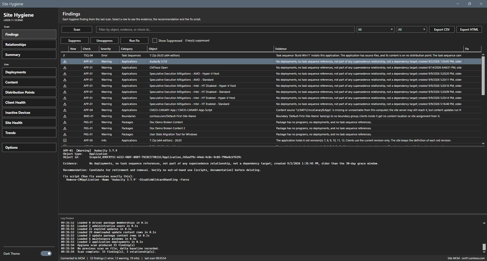

A finding with no fix script has guidance only. **Run Fix** stays disabled for it.

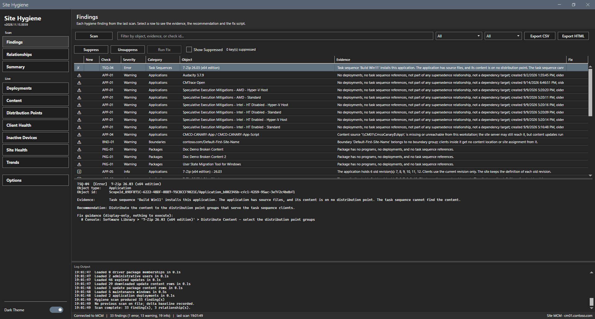

The **New** column marks a finding that the previous scan did not have. The log lists the findings that the last scan resolved.

### Filter the list

1. Type text in the filter box. The grid keeps the rows whose object, evidence or check ID contains the text.
2. Select a category in the first list, for example **Packages**.
3. Select a severity in the second list: **All**, **Error**, **Warning** or **Info**.

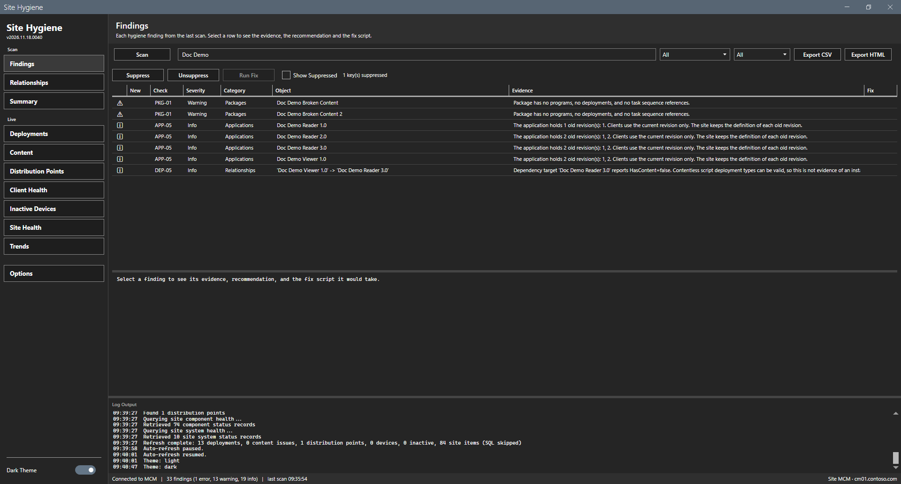

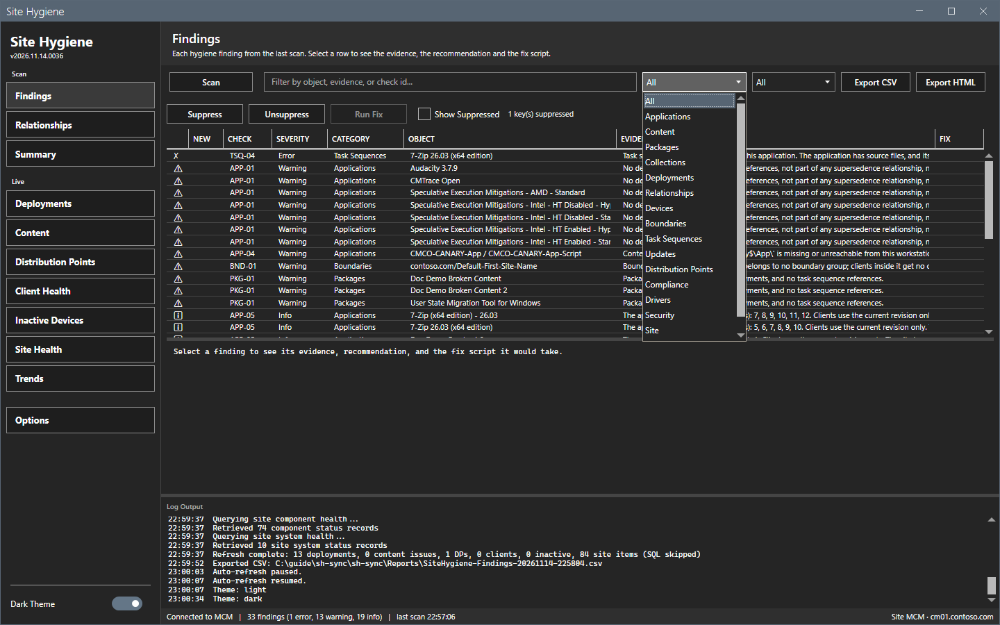

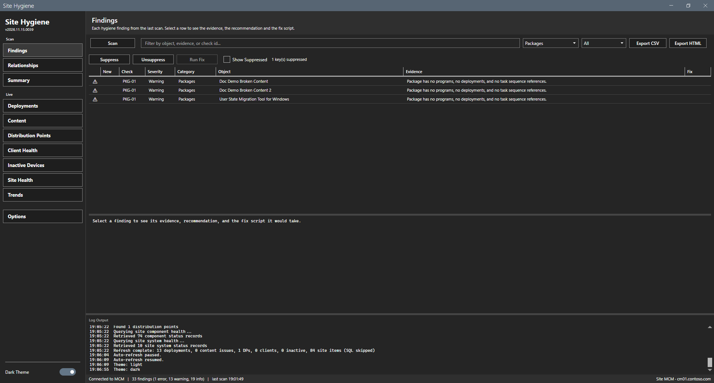

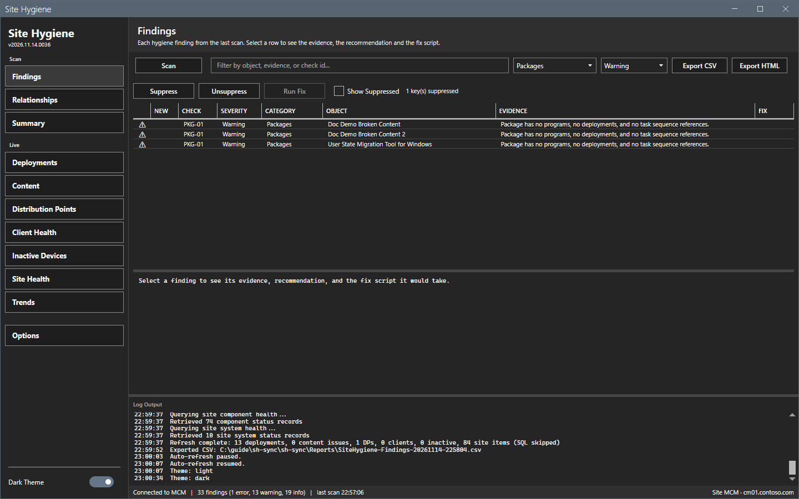

### Suppress a finding

1. Select one row or several rows.
2. Select **Suppress**. The rows leave the list and the counter shows `1 key(s) suppressed`. Later scans do not show the finding.

3. To see the suppressed findings, select **Show Suppressed**.

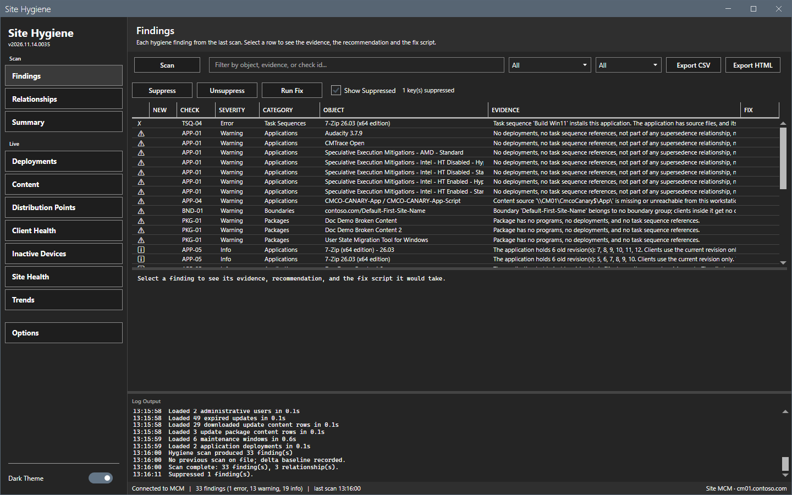

4. To bring a finding back, select it and select **Unsuppress**.

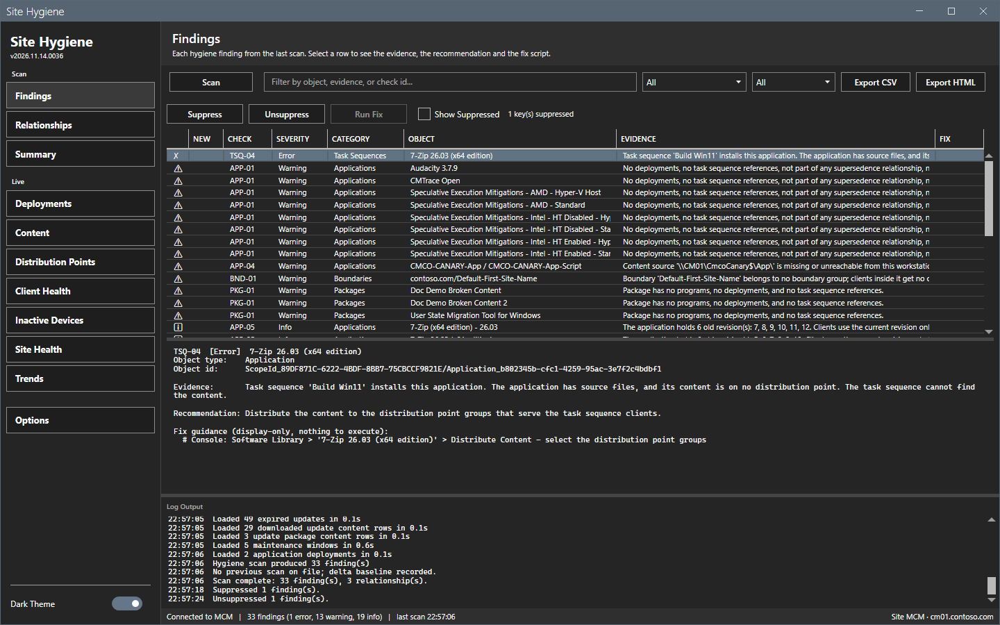

### Run a fix

1. Select a row whose fix script is shown. **Run Fix** becomes enabled. A selection of several rows runs as one bulk fix.
2. Select **Run Fix**. A dialog shows the exact script and the site code. The title is `Run Fix for <check ID>?` for one row or `Run <n> Fixes?` for several rows.
3. Review the script. Select **Yes** to run it or **No** to cancel.

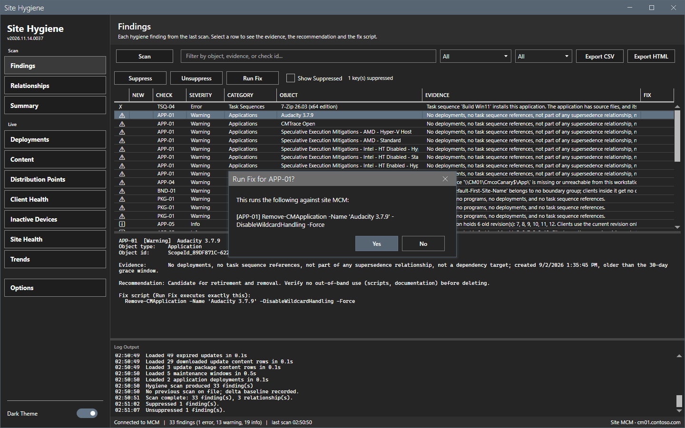

4. After **Yes**, the tool logs the script before it runs and the result after. The status bar shows `Fix(es) applied - rescan to confirm.` or `Some fixes failed - see log.` Run a scan to confirm the result.

This guide does not run a fix. The dialog was opened and cancelled with **No** for the image. The result of a fix on a site was not checked.

### Fix a broken supersedence

A broken supersedence is a rule of an application that points at an application that was deleted. Clients that evaluate it can report errors for other deployments. Check SUP-01 finds it. The finding has no script. **Fix Supersedence** has a window of its own.

1. Select one or more SUP-01 rows. **Fix Supersedence** becomes enabled. It acts on the selected SUP-01 rows only.
2. Select **Fix Supersedence**. The window reads each application from the site and lists the plan: the application, the deployment type and the reference that goes. Nothing changes yet.

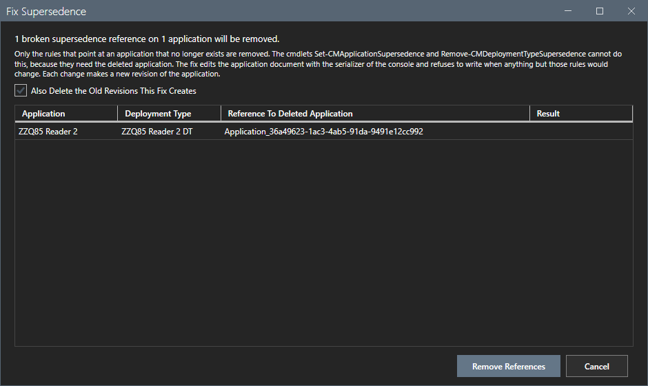

3. Check the list. The check box **Also Delete the Old Revisions This Fix Creates** is on by default. Clear it to keep the old revisions. Select **Cancel** to close the window with no change. Select **Remove References** to continue.
4. The tool removes only the rules that point at an application that no longer exists. A rule that also points at an application that still exists stays. Before it writes, it checks that the serializer is the one of the console and that the edited document is the original without those rules and nothing else. After the write it reads each application again and checks the same. It writes no file of the removed data.
5. The change makes a new revision of the application. With the check box on, the tool then deletes the older revisions of exactly the applications that it changed, so that check APP-05 does not report them. The site refuses to delete a revision that another object still uses: the tool keeps that revision, says so in the result and does not fail the run.
6. The window shows `<n> removed, <n> failed, <n> skipped.`, the result of check SUP-01 run again on the changed applications and the old revisions that are left on them. The log has a line for each change with the names of the application and the deployment type. The rows that were fixed show `Fixed`. Run a scan to confirm on the whole site.

The tool does not use `Set-CMApplicationSupersedence -RemoveSupersedence` for this fix. The cmdlet needs the superseded application and its deployment type as parameters, and the deleted application has neither. The cmdlet answers `No object corresponds to the specified parameters`. The deprecated `Remove-CMDeploymentTypeSupersedence` needs the same objects. So the fix edits the application document of the superseding application with the serializer of the console, which is why it checks the document before and after the write.

### Fix a retired or superseded application

The rule is that no active application depends on or supersedes a retired application, and that no task sequence installs a retired or superseded one. The checks that apply it:

| Check | Finding | **Run Fix** |
|---|---|---|
| SUP-04 | A supersedence rule whose target is retired. | Removes the rule. |
| DEP-04 | A dependency on a retired application. | Removes the dependency. |
| APP-07 | A retired application that still supersedes or depends on an active application. | Removes those rules. A retired application is reinstated for the change and retired again. |
| APP-08 | A superseded application that qualifies for deletion. | Removes the rule of the replacement, then deletes the application. |
| TSQ-05 | A task sequence installs a retired or superseded application. | None. Edit the task sequence in the console. |
| TSQ-06 | Stale reference rows: the site returns reference rows of a task sequence that it does not return. | None. |

1. Select the row. The fix script shows the exact statements. The first removes the rule with `Set-CMApplicationSupersedence -RemoveSupersedence` or `Remove-CMDeploymentTypeDependency`, which work because both applications exist. The next one deletes the old revisions that the change makes, so that check APP-05 does not report them. A revision that another object still uses stays, and the fix does not fail.
2. Select **Run Fix** and confirm the script. A task sequence is never edited by a fix.

### See what blocks the delete of an application

1. Select a finding of an application, for example APP-08.
2. Select **Show Blockers**. The window lists every object that refers to the application: a deployment (the collection), a task sequence (name and package ID), a task sequence that holds that task sequence, another application that depends on it or supersedes it, and a stale reference.
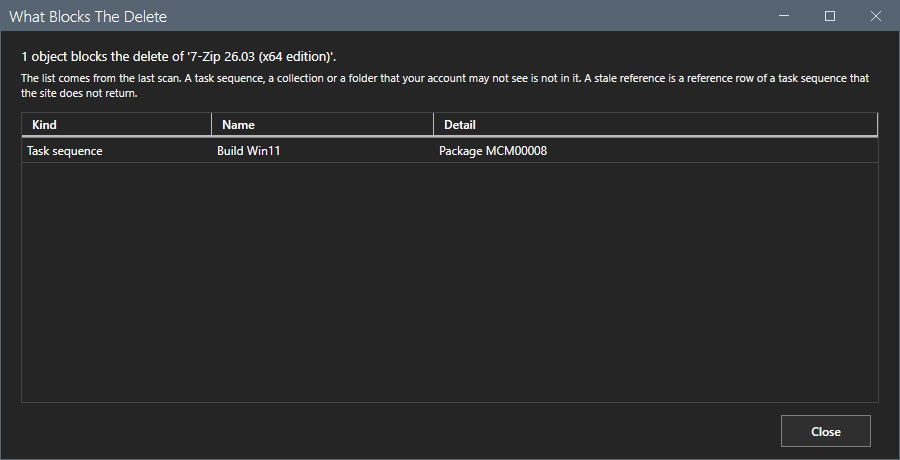

3. The list comes from the last scan and reads nothing from the site. A task sequence, a collection or a folder that your account may not see is not in it. The site can still refuse the delete for such an object.

A **stale reference** is a reference row of a task sequence that the site does not return: the task sequence was deleted, or it is outside the scope of your account. The row still blocks the delete of the application. A task sequence step that names a retired application is found through the task sequence itself, because the reference rows leave out a retired application.

### Export the findings

1. Select **Export CSV** or **Export HTML**. The tool writes the rows that the filters show.
2. In the Save As dialog, keep the name or type a new name. The folder is `Reports` beside the script. The name is `SiteHygiene-Findings-<date>-<time>`.
3. Select **Save**. The log shows `Exported CSV:` and the path.

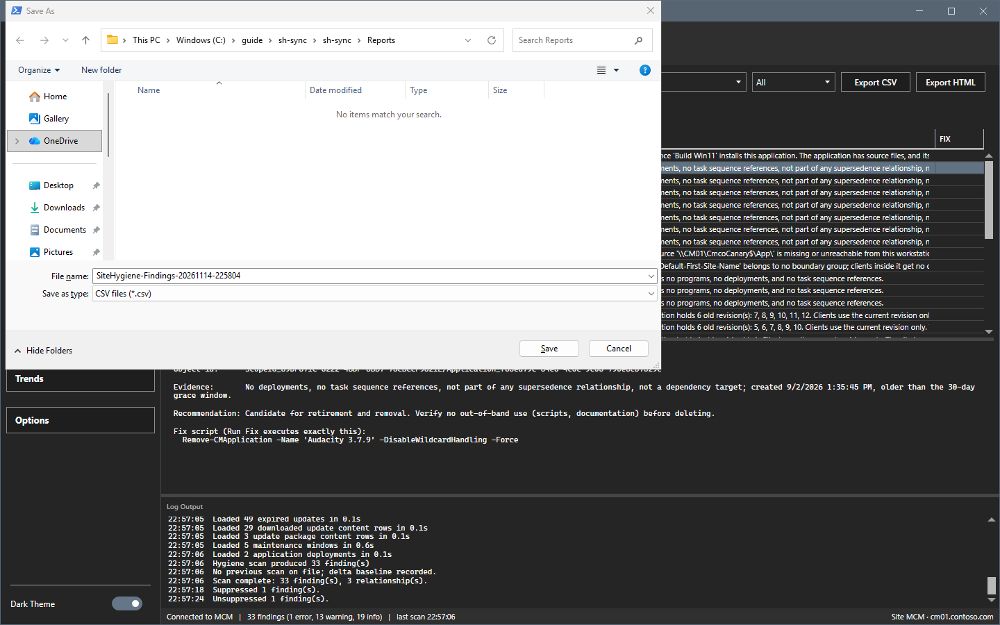

The CSV and the HTML files carry the evidence, the recommendation and the fix script of each finding. The HTML file colors the severity.

## Options and settings of this page

| Control | Effect |
|---|---|
| **Scan** | Runs a scan of the areas set in **Options > Scan**. |
| Filter box | Keeps the rows that contain the text. |
| Category list | Keeps the rows of one category. |
| Severity list | Keeps the rows of one severity. |
| **Export CSV**, **Export HTML** | Write the shown rows to a file. |
| **Suppress**, **Unsuppress** | Hide or show the selected findings in later scans. |
| **Run Fix** | Runs the fix script of the selected rows after a confirmation. |
| **Show Blockers** | Lists every object that refers to the selected application and so blocks its delete. |
| **Fix Supersedence** | Opens the plan of the selected SUP-01 rows. **Remove References** removes the references and, with the check box on, the old revisions of the changed applications. |
| **Show Suppressed** | Shows the suppressed findings in the grid. |

## Limits

- **Run Fix** is enabled only for a finding with an executable fix script. Guidance text never runs.
- **Fix Supersedence** is enabled only for SUP-01 findings. The other supersedence checks (SUP-02, SUP-03, SUP-04) have guidance only.
- **Fix Supersedence** removes a rule only when every application that the rule names is gone. It never edits a rule that names an application that still exists.
- A scan blocks a second scan, a refresh and a fix while it runs.
- A suppression is a key. It hides every finding with that key, also after a rescan.

## Troubleshooting

| Message or symptom | Cause | Fix |
|---|---|---|
| **Run Fix** is disabled. | No row is selected, or the finding has guidance only. | Select a row with a fix script. |
| The grid is empty after a scan. | A filter hides the rows, or the scan found nothing. | Clear the filters. Select **Show Suppressed**. |
| The status bar shows `Fix failed - see log.` | The fix script failed on the site. | Review the log line `Fix failed [<check>]`. |
| **Fix Supersedence** is disabled. | No SUP-01 row is selected, or the row shows `Fixed`. | Select a SUP-01 row. |
| The window says `Nothing to remove.` | The reference is no longer broken, or the rule is gone. | Scan again. |
| The window says `The edited document differs from the original in more than the broken rules, so nothing was changed.` | The serializer would change more than the rule. | Remove the reference in the console. |
| The window says `The serializer ... differs` or `is not the one of the console`. | The serializer that the tool loaded is not the one of the installed console. | Start the tool again after you repair the console installation. |

## Links

- [Checks](../reference/checks.md)
- [Summary](summary.md)
- [Files and logs](../reference/files-and-logs.md)
