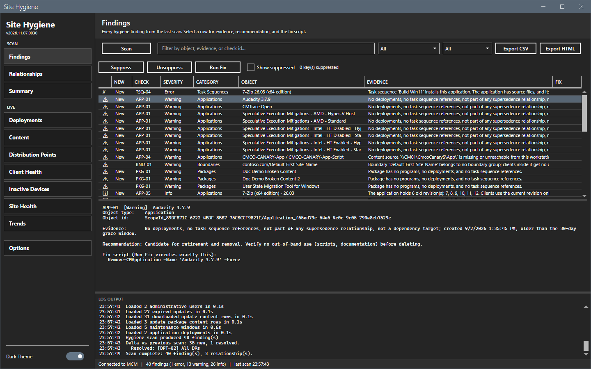
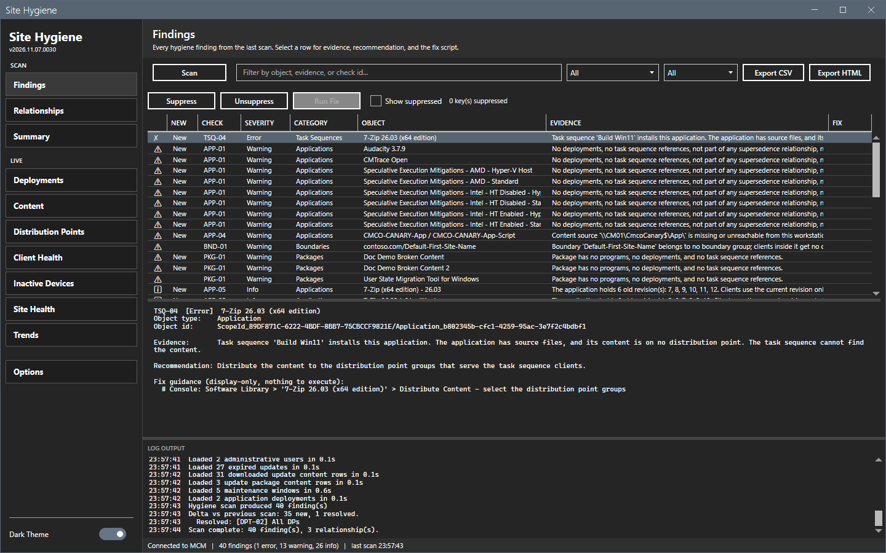
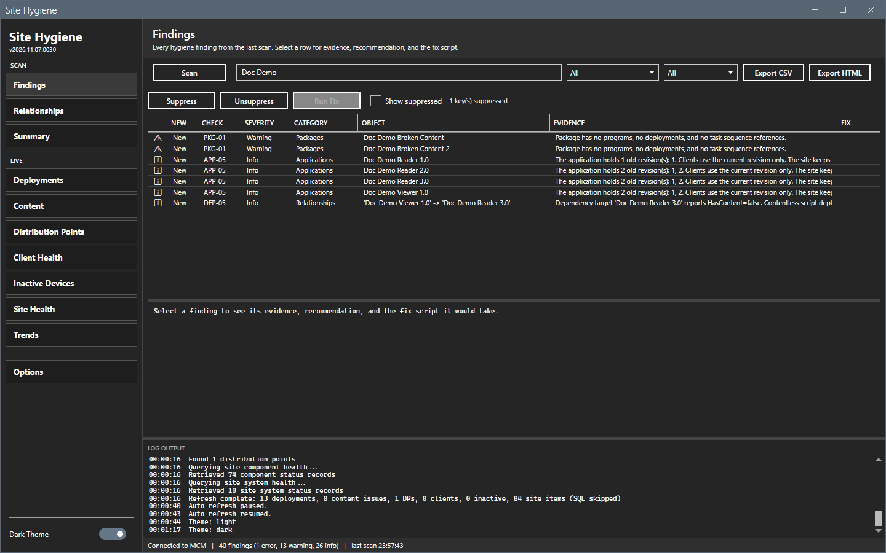
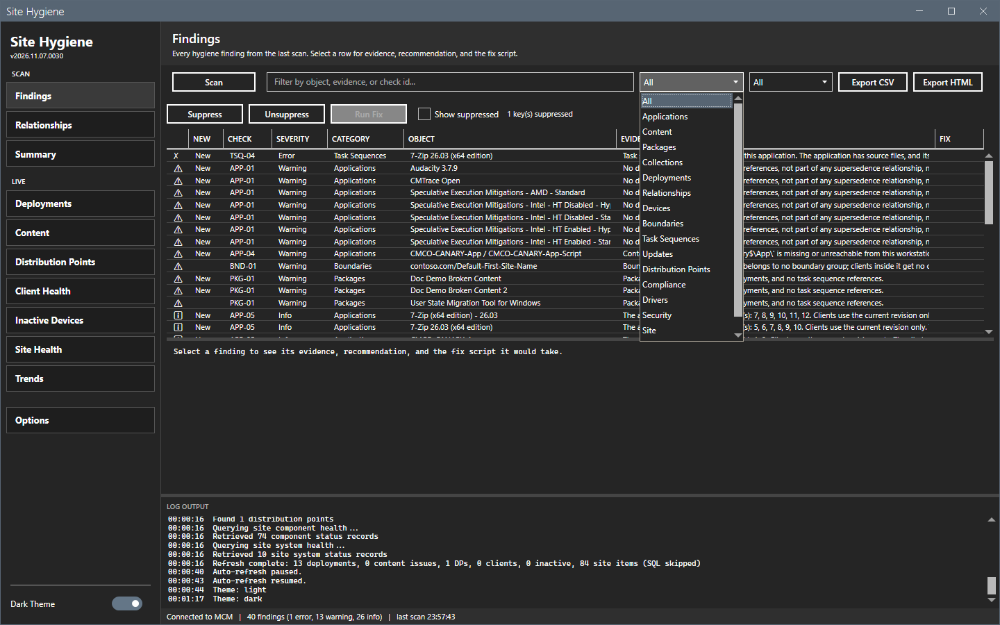
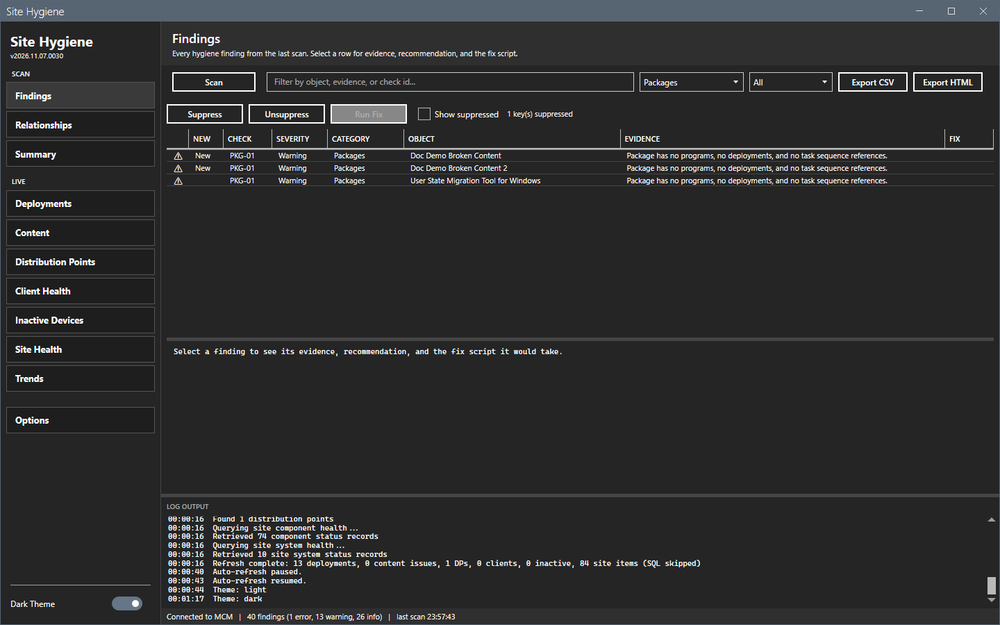
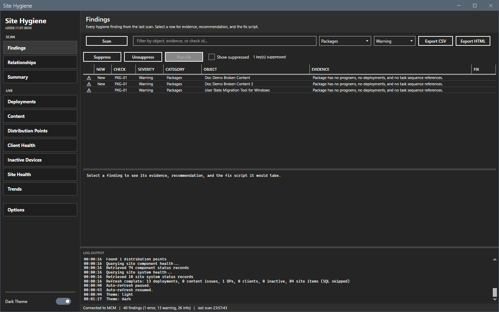
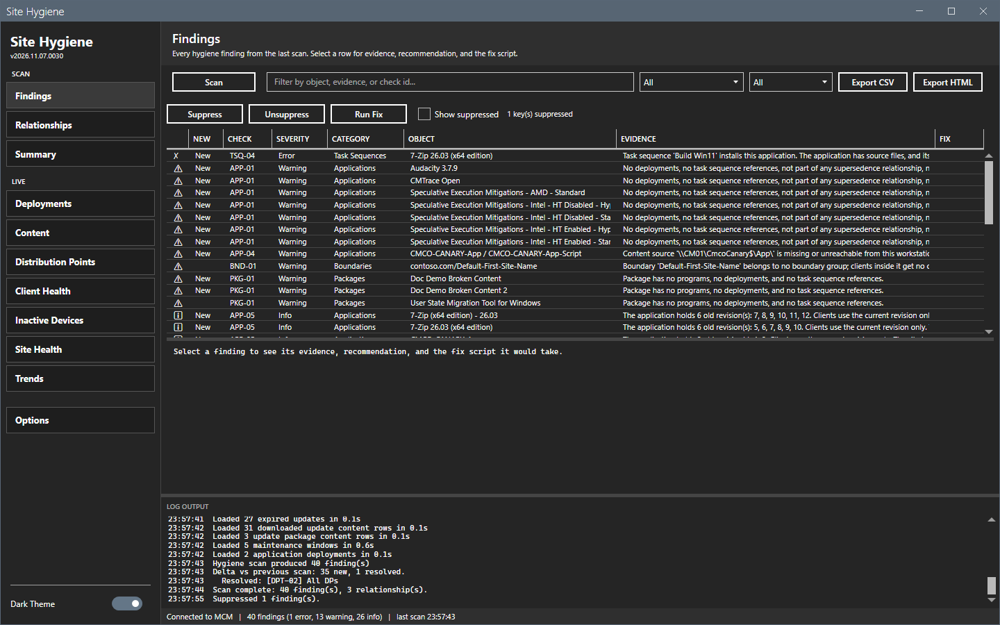
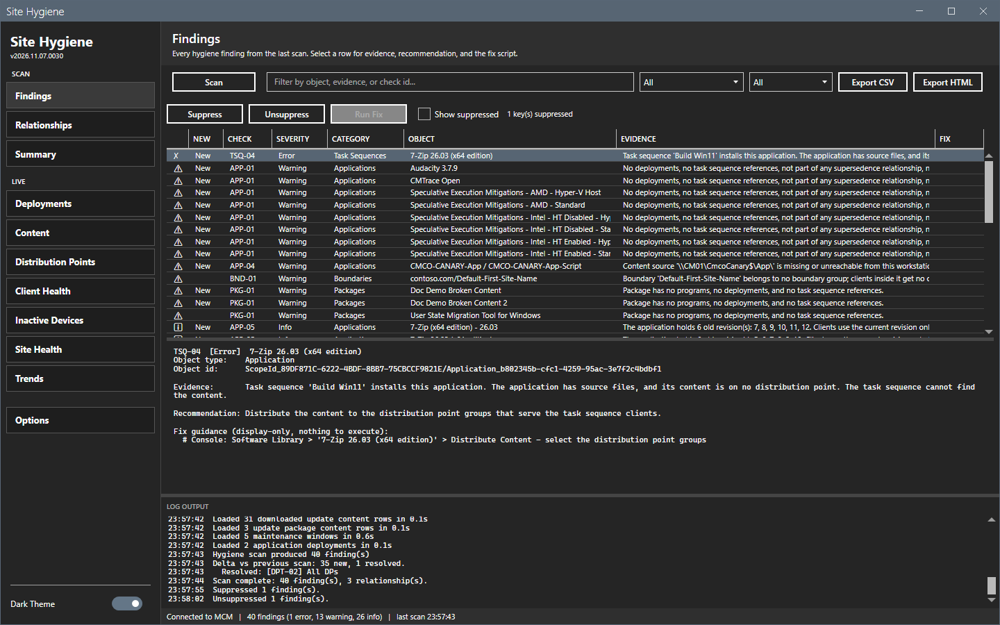
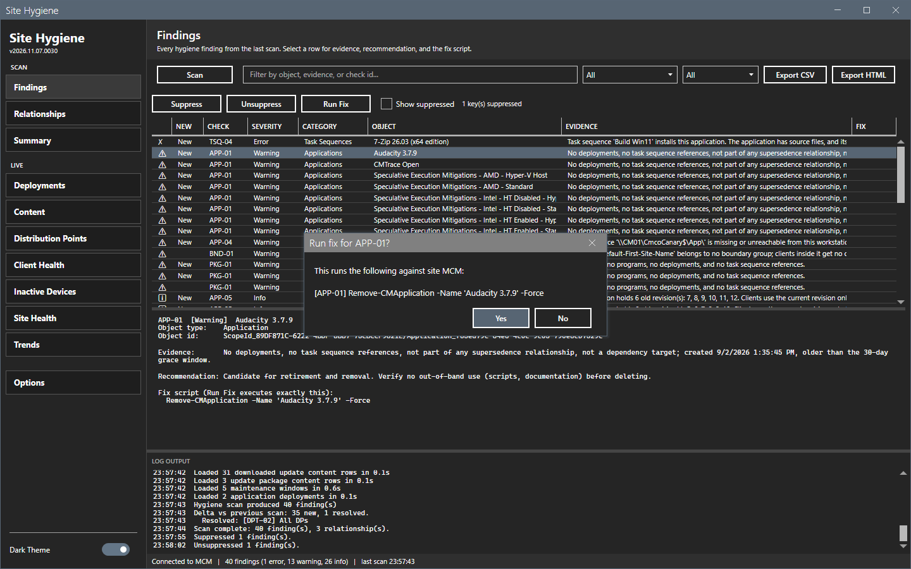
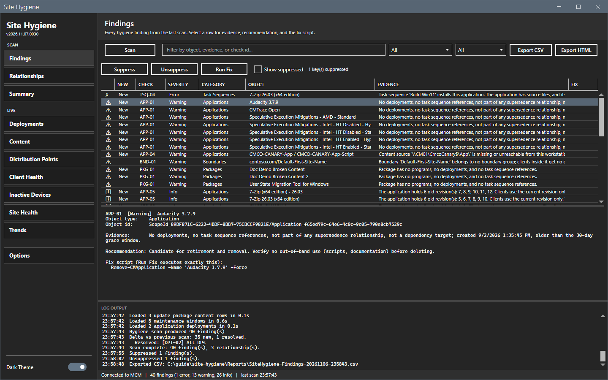

# Findings

The Findings view lists every finding of the last scan.

## What it does

A scan runs the checks of [Checks](../reference/checks.md) over the data of the site. Each finding shows the object, the evidence, a recommendation and the PowerShell that a fix would run. **Suppress** hides an accepted finding. **Run Fix** runs the fix script of a finding after you confirm the script in a dialog. A scan never changes the site.

## When to use it

Use it after a scan, to decide for each finding whether to fix it, to suppress it or to leave it.

## Requirements

- A connection. See [Getting started](../getting-started.md).
- At least one scan.
- For **Run Fix**: the Configuration Manager rights that the fix script itself needs. See [Permissions](../reference/permissions.md).

## Steps

### Read a finding

1. Select **Scan**, or open the view after a scan.
2. Select a row. The pane below the grid shows the check, the severity, the object, the evidence and the recommendation. It also shows the fix script, or the text `Fix guidance (display-only, nothing to execute)`.

A finding with no fix script has guidance only. **Run Fix** stays disabled for it.

The **New** column marks a finding that the previous scan did not have. The log lists the findings that the last scan resolved.

### Filter the list

1. Type text in the filter box. The grid keeps the rows whose object, evidence or check ID contains the text.
2. Select a category in the first list, for example **Packages**.
3. Select a severity in the second list: **All**, **Error**, **Warning** or **Info**.

### Suppress a finding

1. Select one row or several rows.
2. Select **Suppress**. The rows leave the list and the counter shows `1 key(s) suppressed`. Later scans do not show the finding.

3. To see the suppressed findings, select **Show suppressed**.

4. To bring a finding back, select it and select **Unsuppress**.

### Run a fix

1. Select a row whose fix script is shown. **Run Fix** becomes enabled. A selection of several rows runs as one bulk fix.
2. Select **Run Fix**. A dialog shows the exact script and the site code. The title is `Run fix for <check ID>?` for one row or `Run <n> fixes?` for several rows.
3. Read the script. Select **Yes** to run it or **No** to cancel.

4. After **Yes**, the tool logs the script before it runs and the result after. The status bar shows `Fix(es) applied - rescan to confirm.` or `Some fixes failed - see log.` Run a scan to confirm the result.

This guide does not run a fix. The dialog was opened and cancelled with **No** for the image. The result of a fix on a site was not checked.

### Export the findings

1. Select **Export CSV** or **Export HTML**. The tool writes the rows that the filters show.
2. In the Save As dialog, keep the name or type a new name. The folder is `Reports` beside the script. The name is `SiteHygiene-Findings-<date>-<time>`.
3. Select **Save**. The log shows `Exported CSV:` and the path.

The CSV and the HTML files carry the evidence, the recommendation and the fix script of each finding. The HTML file colors the severity.

## Options and settings of this page

| Control | Effect |
|---|---|
| **Scan** | Runs a scan of the areas set in **Options > Scan**. |
| Filter box | Keeps the rows that contain the text. |
| Category list | Keeps the rows of one category. |
| Severity list | Keeps the rows of one severity. |
| **Export CSV**, **Export HTML** | Write the shown rows to a file. |
| **Suppress**, **Unsuppress** | Hide or show the selected findings in later scans. |
| **Run Fix** | Runs the fix script of the selected rows after a confirmation. |
| **Show suppressed** | Shows the suppressed findings in the grid. |

## Limits

- **Run Fix** is enabled only for a finding with an executable fix script. Guidance text never runs.
- A scan blocks a second scan, a refresh and a fix while it runs.
- A suppression is a key. It hides every finding with that key, also after a rescan.

## Troubleshooting

| Message or symptom | Cause | Fix |
|---|---|---|
| **Run Fix** is disabled. | No row is selected, or the finding has guidance only. | Select a row with a fix script. |
| The grid is empty after a scan. | A filter hides the rows, or the scan found nothing. | Clear the filters. Select **Show suppressed**. |
| The status bar shows `Fix failed - see log.` | The fix script failed on the site. | Read the log line `Fix failed [<check>]`. |

## Links

- [Checks](../reference/checks.md)
- [Summary](summary.md)
- [Files and logs](../reference/files-and-logs.md)
