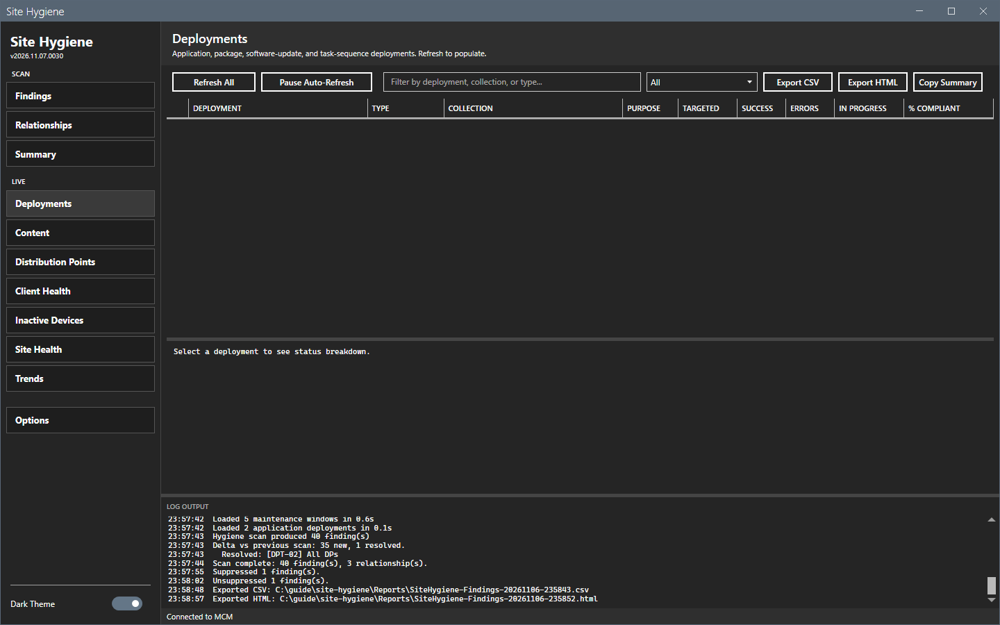
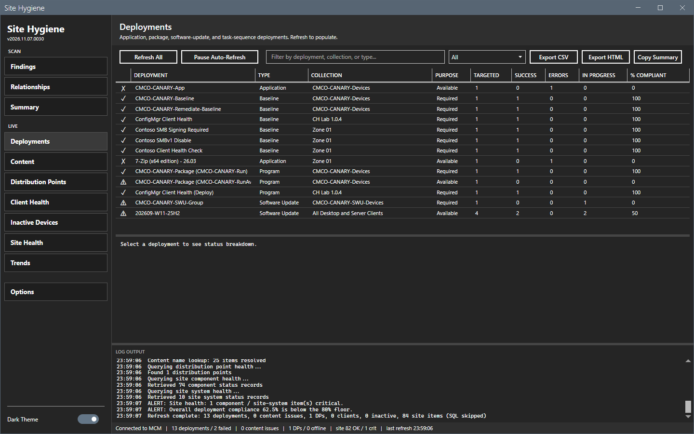
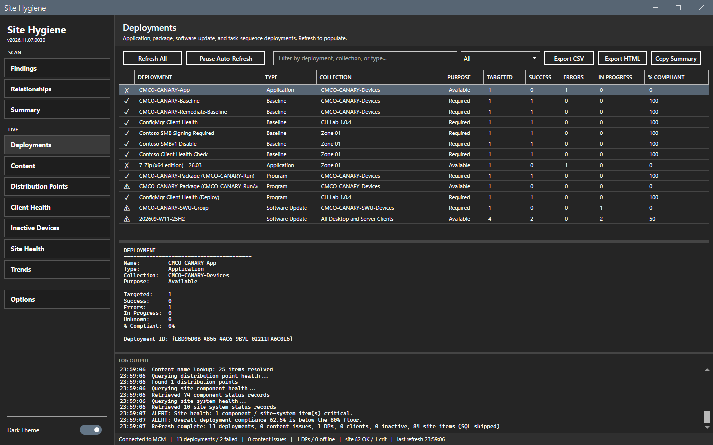
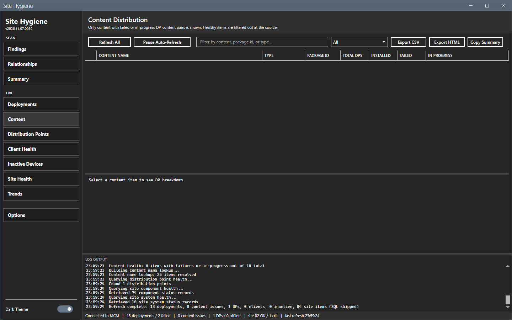
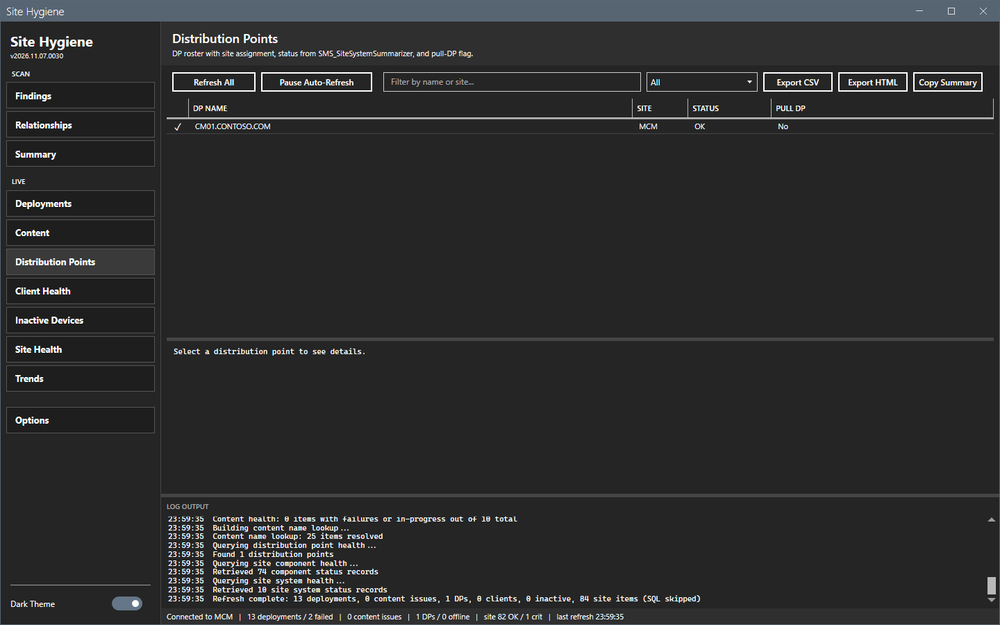
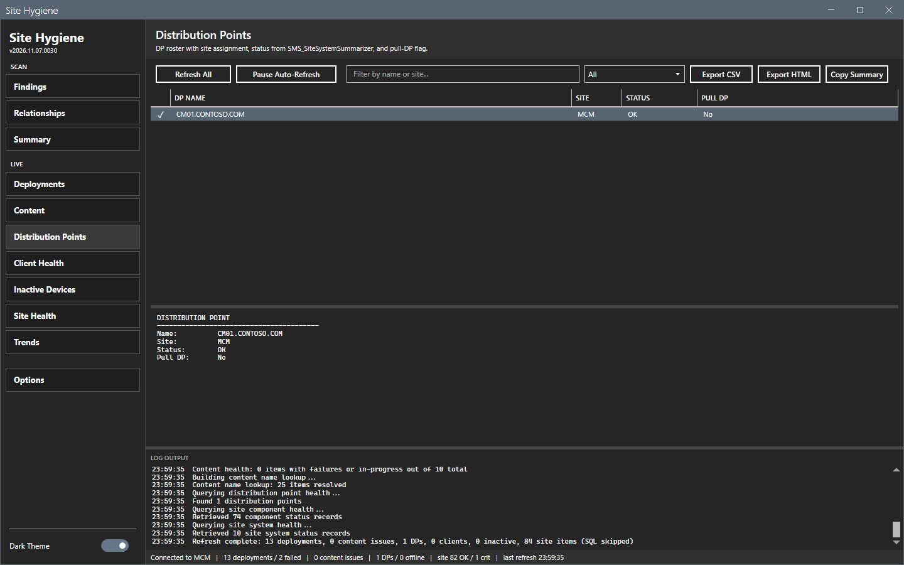
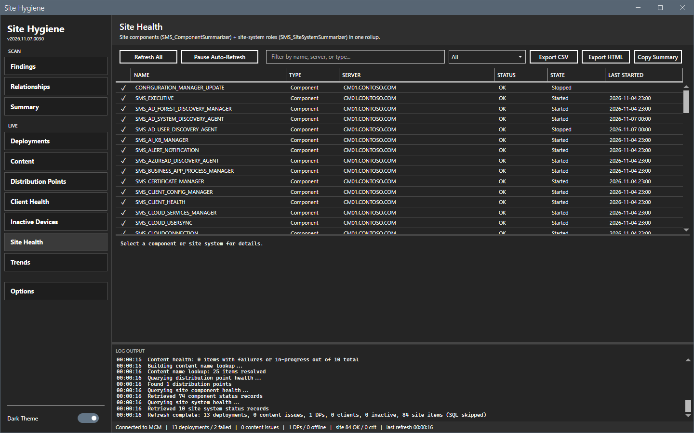
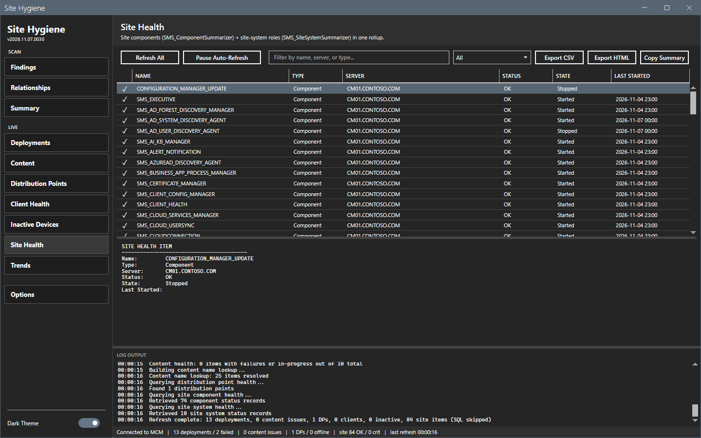
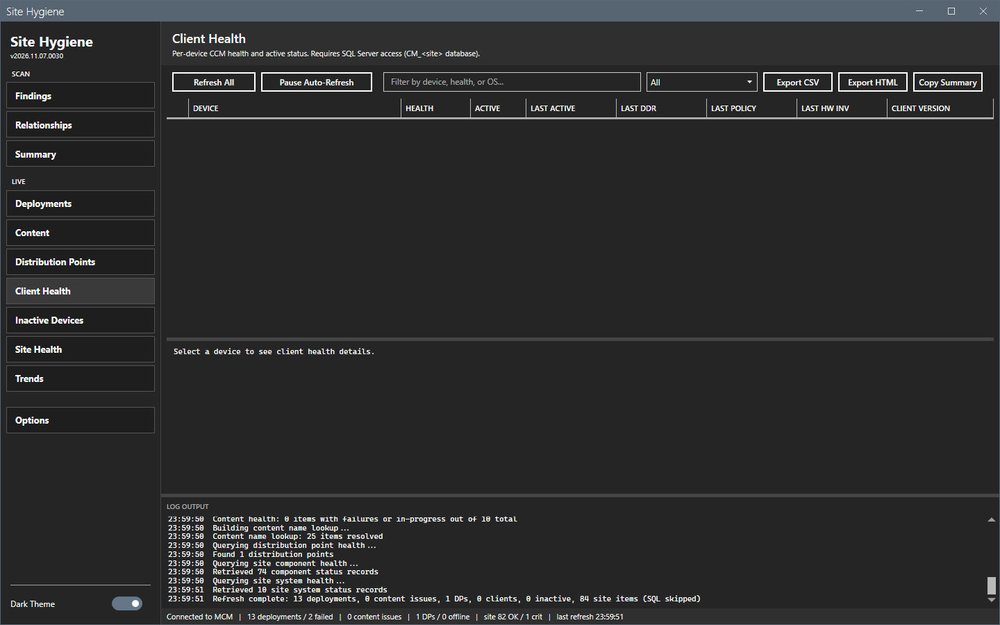
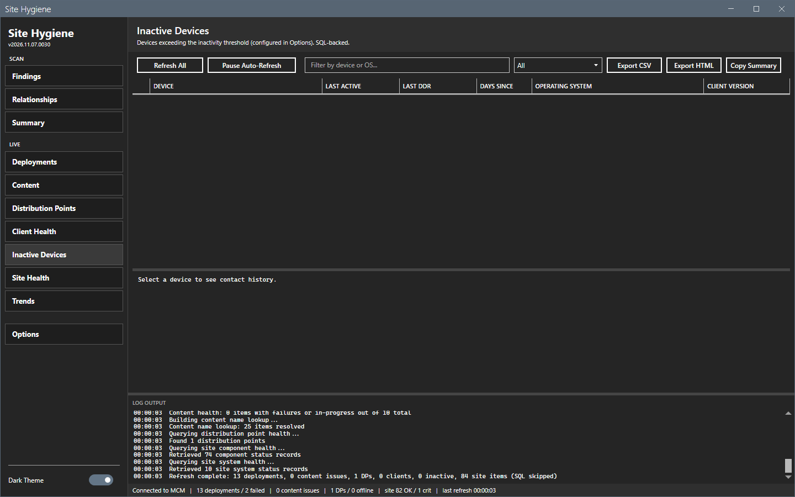

# Live views

The Live group of the sidebar shows the current status of the site. It has six views: Deployments, Content, Distribution Points, Client Health, Inactive Devices and Site Health.

## What it does

**Refresh All** runs every live query at once. Each view shows its own part of the result. The views create no findings and change nothing on the site. The status bar shows the totals of the last refresh.

| View | What it shows | Source |
|---|---|---|
| **Deployments** | Every deployment with the number of targeted, successful, failed and in-progress devices and the compliance in percent. | `Get-CMDeployment` |
| **Content** | Only the content with a failed or in-progress distribution point. Healthy content is not shown. | `SMS_PackageStatusDistPointsSummarizer` |
| **Distribution Points** | Each distribution point with the site, the status and the pull DP flag. | `Get-CMDistributionPoint` and `SMS_SiteSystemSummarizer` |
| **Client Health** | The health of the Configuration Manager client of each device. | SQL view `v_CH_ClientSummary` |
| **Inactive Devices** | The devices without contact for more than the threshold of **Options > Live**. | SQL |
| **Site Health** | The site components and the site system roles in one list. | `SMS_ComponentSummarizer` and `SMS_SiteSystemSummarizer` |

## When to use it

Use it to check a site in the morning, to find a failed deployment or distribution, and to find a component in a critical state.

## Requirements

- A connection. See [Getting started](../getting-started.md).
- For **Client Health** and **Inactive Devices**: a SQL Server in **Options > Connection**, the `SqlServer` PowerShell module and read access to the `CM_<site>` database.

## Steps

### Refresh the views

1. Select a Live view. The view is empty before the first refresh.

2. Select **Refresh All**. A progress overlay shows. The log lists each query.
3. Read the grid. The first column holds a status glyph: a check mark for OK, a warning sign for a warning or in progress, a cross for failed or critical and an ellipsis for unknown.
4. Select a row. The pane below the grid shows the details.

### Filter a view

1. Type text in the filter box. Each view matches its own columns, for example the deployment, the collection and the type.
2. Select a status in the list: **All**, **OK / Healthy**, **Warning / In Progress** or **Failed / Error**.

### Read each view

The **Content** view has rows only when a distribution failed or runs. An empty grid means that all content is healthy.

The **Distribution Points** view lists each distribution point.

The **Site Health** view lists components and site systems. A status of `Critical` and a state of `Stopped` show a problem.

### Client Health and Inactive Devices without a SQL Server

When **SQL Server** is empty in **Options > Connection**, the two views stay empty after a refresh. The log shows `SQL skipped`. Set the SQL Server and refresh again.

### Export and copy

1. Select **Export CSV** or **Export HTML**. The tool writes the rows as shown to the `Reports` folder.
2. Select **Copy Summary**. The tool puts a text rollup of the last refresh on the clipboard.

## Options and settings of this page

| Control | Effect |
|---|---|
| **Refresh All** | Runs every live query. |
| **Pause Auto-Refresh** | Holds the timer. See [Trends and alerts](trends-and-alerts.md). |
| Filter box and status list | Filter the rows of the view. |
| **Export CSV**, **Export HTML** | Write the rows as shown. |
| **Copy Summary** | Copies the rollup of the last refresh. |

The interval and the inactivity threshold are on [Options dialog](options.md).

## Limits

- The views read the site when you refresh. They do not update by themselves, except by the auto-refresh timer.
- The status filter uses the glyph of the first column.
- **Client Health** and **Inactive Devices** stay empty without a SQL Server. The views show no message in the grid.
- The Content view hides healthy content at the source.

## Troubleshooting

| Message or symptom | Cause | Fix |
|---|---|---|
| The log shows `Refresh failed: Failed to connect to site`. | The provider or the site code is wrong, or the console is missing. | Check [Options dialog](options.md). |
| Client Health is empty. | No SQL Server is set, or the module is missing. | Set **SQL Server** in Options. |
| The view is empty. | No refresh has run. | Select **Refresh All**. |

## Links

- [Trends and alerts](trends-and-alerts.md)
- [Permissions](../reference/permissions.md)
