# Options dialog

The Options dialog sets the connection, the scan scope, the refresh timer and the alerts.

## What it does

The dialog has five pages: **Connection**, **Scan**, **Live**, **Alerts** and **About**. **OK** saves every page. **Cancel** or Esc closes the dialog and keeps the old values.

## When to use it

Use it at the first start, when the site or the SQL Server changes, and to limit a scan to some areas.

## Requirements

None.

## Steps

### Open the dialog

Select **Options** in the sidebar. The dialog opens on the **Connection** page. The first start shows empty fields.

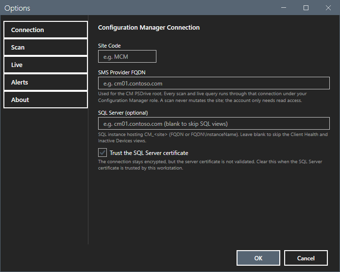

### Connection

| Field | Meaning |
|---|---|
| **Site Code** | The three-character site code, for example `MCM`. |
| **SMS Provider FQDN** | The server that has the SMS Provider role. The tool uses it for the provider connection of the console module. |
| **SQL Server (optional)** | The instance that hosts `CM_<site>`: `FQDN` or `FQDN\Instance`. Blank skips Client Health and Inactive Devices. |
| **Trust the SQL Server certificate** | On by default. The connection stays encrypted, but the server certificate is not validated. Clear it when this computer trusts the certificate. |

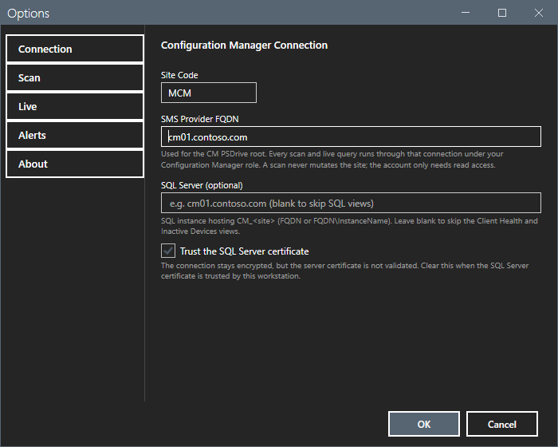

### Scan

1. Select the **Scan** page.
2. Select the areas that a scan reads. The areas marked `(slow)` read one object at a time from the SMS Provider.
3. Optional: type a pause between provider calls in milliseconds, from 0 to 60000. The default is 0.

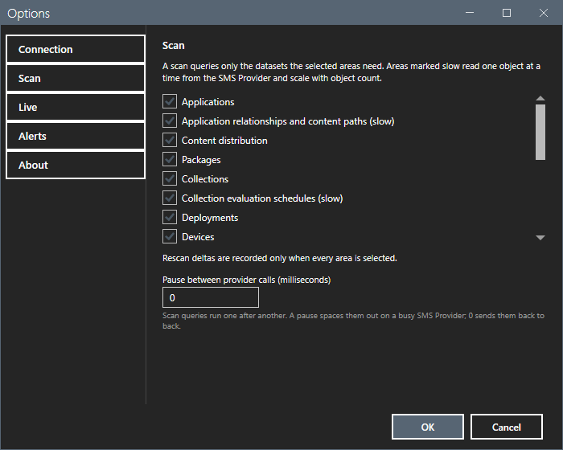

A scan with every area selected records the rescan delta. A scan of some areas leaves the baseline unchanged.

### Live

1. Select the **Live** page.
2. Select the auto-refresh interval in minutes. `0` turns the timer off.
3. Select the inactivity threshold in days. The Inactive Devices view lists the devices with no DDR contact for more days than the threshold.

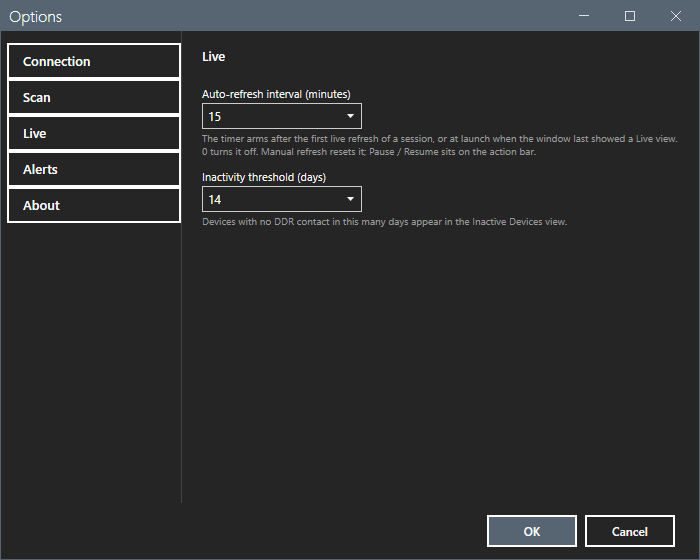

### Alerts

1. Select the **Alerts** page.
2. Select or clear **Enable threshold alerts**.
3. Select the deployment compliance floor in percent.

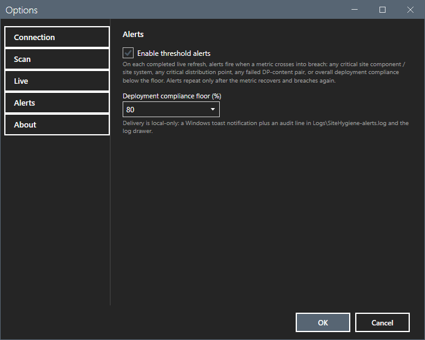

### About

The **About** page shows the version, a short description, the author and the license.

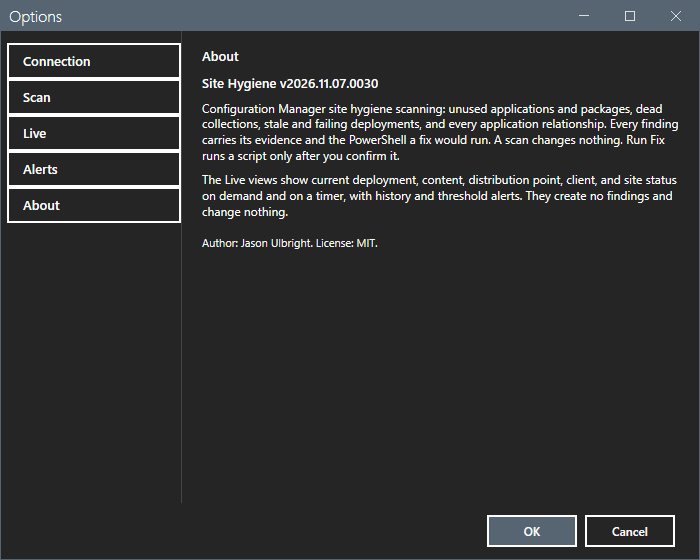

### Theme

The **Dark Theme** switch at the bottom of the sidebar changes the theme of the window and of the dialog. The tool keeps the choice.

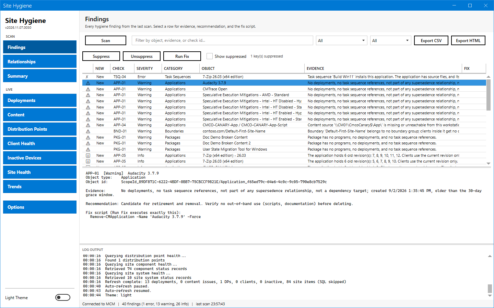

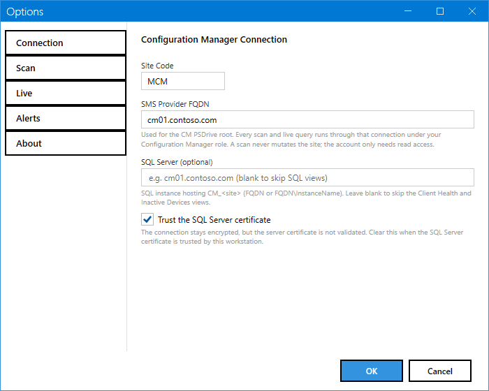

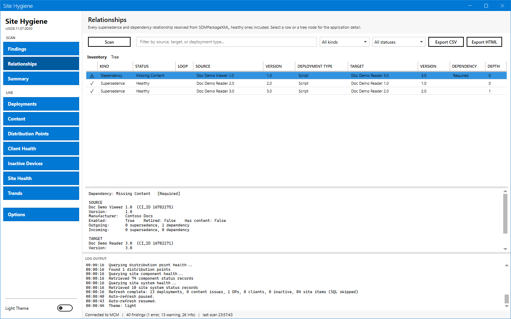

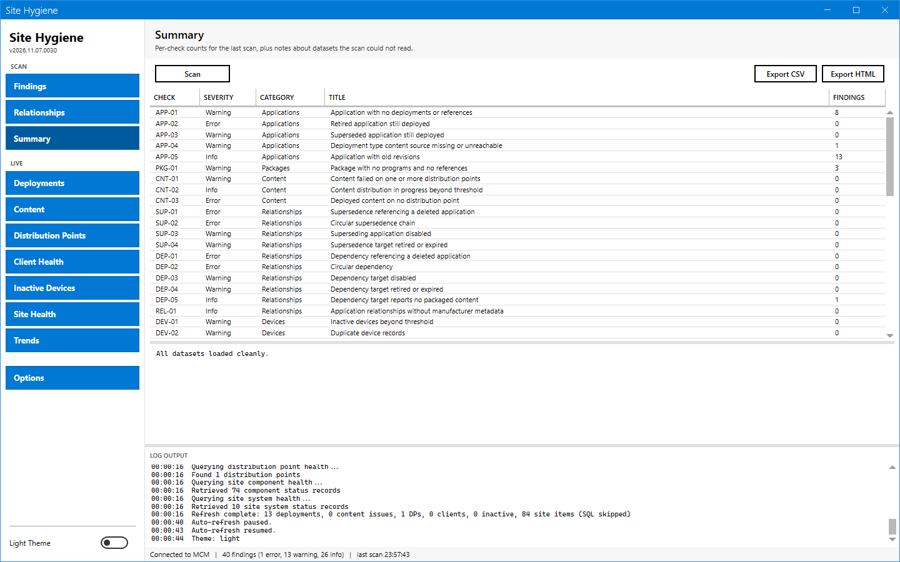

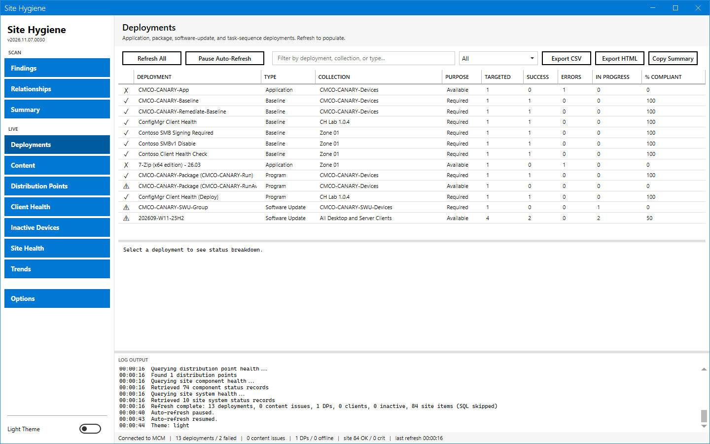

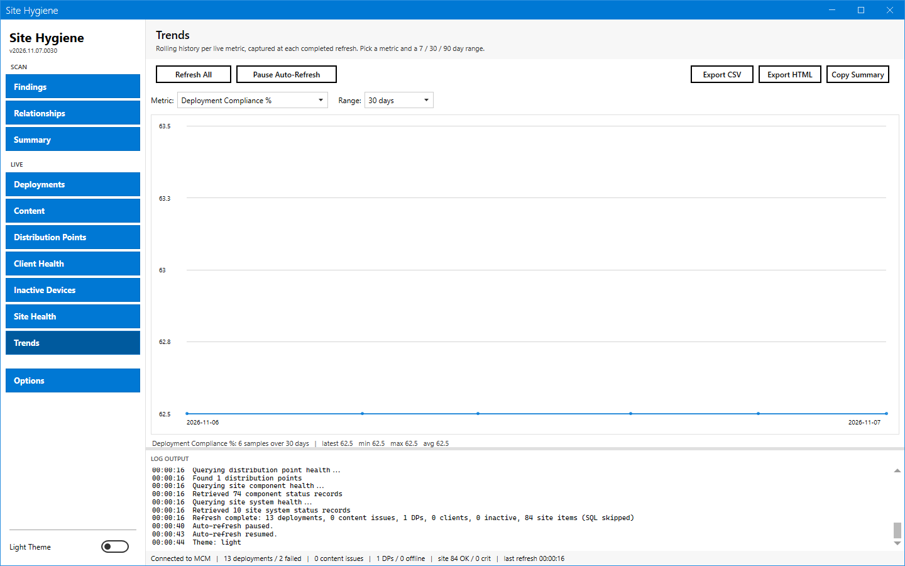

### Start again

The tool saves the open view, the theme and the window place. After a restart the window shows the same view.

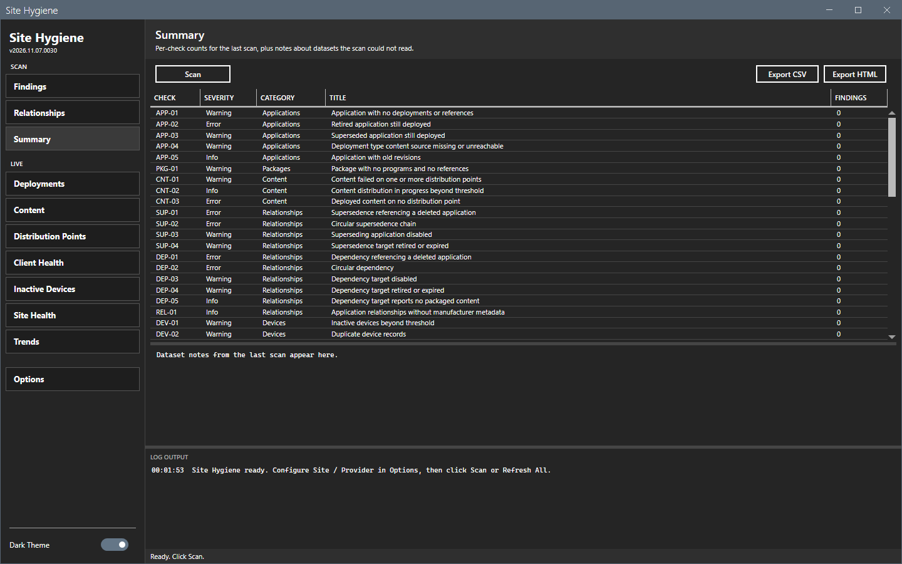

## Options and settings of this page

See the tables above. [Settings](../reference/settings.md) lists the file keys.

## Limits

- Both the site code and the provider are required for a scan and a refresh.
- The scan areas message `Select at least one scan area.` shows when you clear every area. The pause message is `The pause must be a whole number of milliseconds from 0 to 60000.`
- A retired ConfigMgr Health Dashboard install is imported at the start. The import fills only settings that have no value yet.

## Troubleshooting

| Message or symptom | Cause | Fix |
|---|---|---|
| `Select at least one scan area.` | Every area is cleared. | Select an area. |
| `The pause must be a whole number of milliseconds from 0 to 60000.` | The pause is not a number in range. | Type a whole number from 0 to 60000. |

## Links

- [Settings](../reference/settings.md)
- [Getting started](../getting-started.md)
