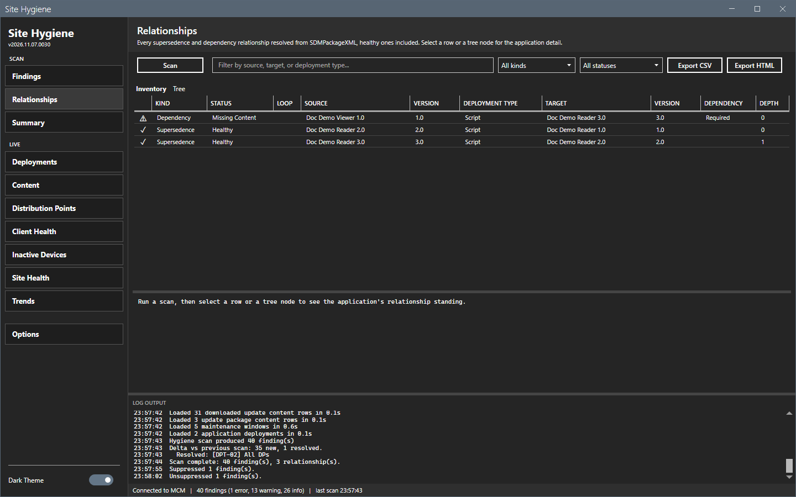
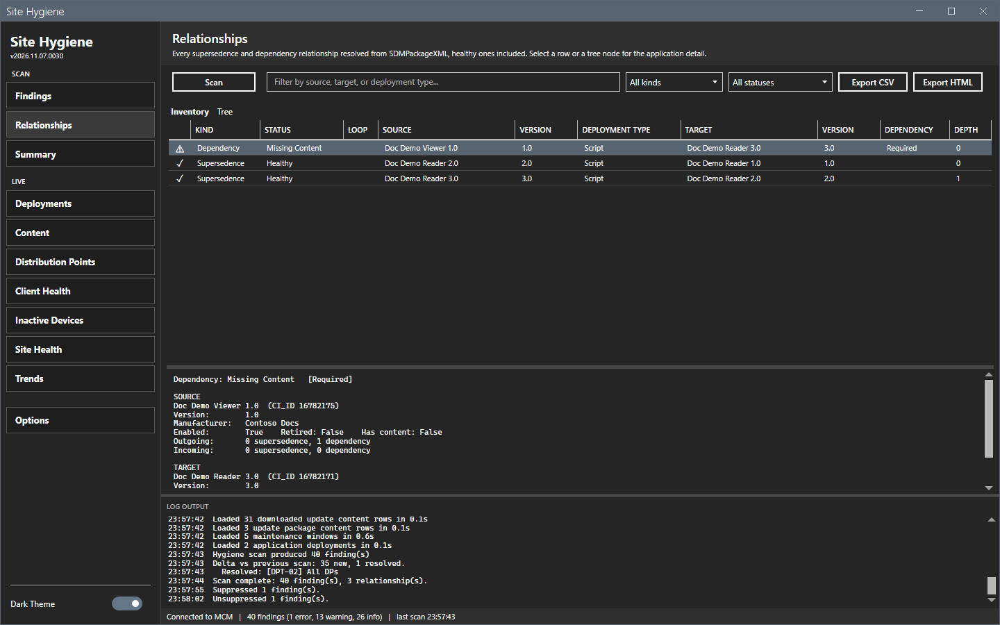
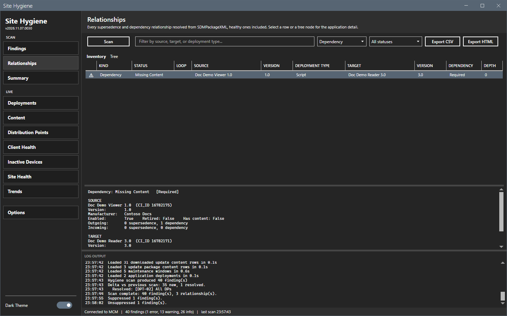
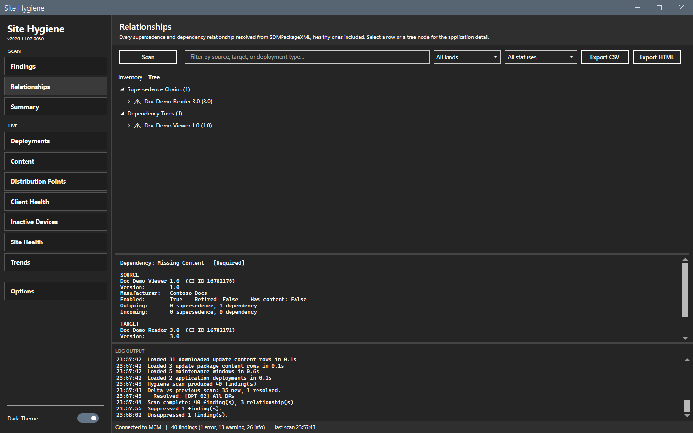

# Relationships

The Relationships view lists every supersedence and dependency relationship that the last scan found.

## What it does

The **Inventory** tab lists each relationship, also the healthy ones, with the kind, the status, a loop flag, the source and target application and version, the deployment type, the dependency state and the depth of the supersedence chain. The **Tree** tab shows supersedence chains and dependency trees with a health glyph on each node. The pane below shows the standing of the selected application.

## When to use it

Use it to find supersedence and dependency problems: a target that was deleted, retired or disabled, and a circular chain.

## Requirements

- A scan that includes the area **Application relationships and content paths**. See [Options dialog](options.md).

## Steps

### Read the inventory

1. Select **Relationships** in the sidebar.
2. Read the grid. Select a row. The pane shows the source and the target application with the manufacturer, the enabled and retired state and the number of incoming and outgoing relationships.

### Filter the inventory

1. Type text in the filter box. The grid matches the source, the target and the deployment type.
2. Select a kind in the first list: **All kinds**, **Supersedence** or **Dependency**.
3. Select a status in the second list: **All statuses**, **Healthy** or **Broken**.

### Read the tree

1. Select the **Tree** tab.
2. Open a node. Select a node to see the standing of the application.

## Options and settings of this page

| Control | Effect |
|---|---|
| **Scan** | Runs a scan. |
| Filter box, kind list, status list | Filter the inventory. |
| **Export CSV**, **Export HTML** | Write the inventory as shown. |
| **Inventory**, **Tree** | Switch the tab. The selected tab is bold. |

## Limits

- The view is empty until a scan has run.
- The status follows the supersedence and dependency checks. The loop flag is separate, because a circular edge can also have a retired or disabled end.
- The view reads the last scan. It does not change when the site changes.

## Troubleshooting

| Message or symptom | Cause | Fix |
|---|---|---|
| The pane shows `Run a scan, then select a row`. | No scan has run. | Select **Scan**. |
| The grid has no rows after a scan. | The area **Application relationships and content paths** was cleared, or the site has no relationships. | Select the area in **Options > Scan** and scan again. |

## Links

- [Findings](findings.md)
- [Checks](../reference/checks.md)
