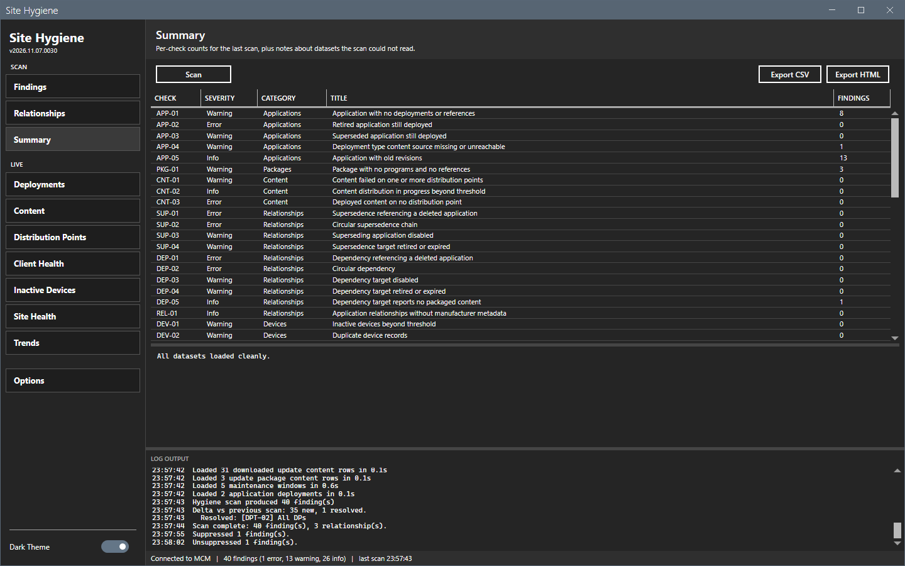

# Summary

The Summary view lists every check with the number of its findings from the last scan.

## What it does

Each row shows the check ID, the severity, the category, the title and the number of findings. The pane below the grid lists the datasets that could not be read. A dataset that fails to load becomes empty, and the note names the checks that can report too little or too much because of it.

## When to use it

Use it to see which checks found something, and to learn whether the scan could read all data.

## Requirements

At least one scan.

## Steps

1. Select **Summary** in the sidebar.
2. Read the **Findings** column. A check with `0` found nothing.
3. Read the pane below the grid. `All datasets loaded cleanly.` means that every dataset loaded.

## Options and settings of this page

| Control | Effect |
|---|---|
| **Scan** | Runs a scan. |
| **Export CSV**, **Export HTML** | Write the table. |

## Limits

- A check that is not in the scan scope shows `0`.
- A check shows `0` also when its data did not load. Read the note.

## Troubleshooting

| Message or symptom | Cause | Fix |
|---|---|---|
| The note names a dataset. | The read failed. | Read the log for the reason. Scan again. |
| The grid is empty. | No scan has run. | Select **Scan**. |

## Links

- [Findings](findings.md)
- [Checks](../reference/checks.md)
