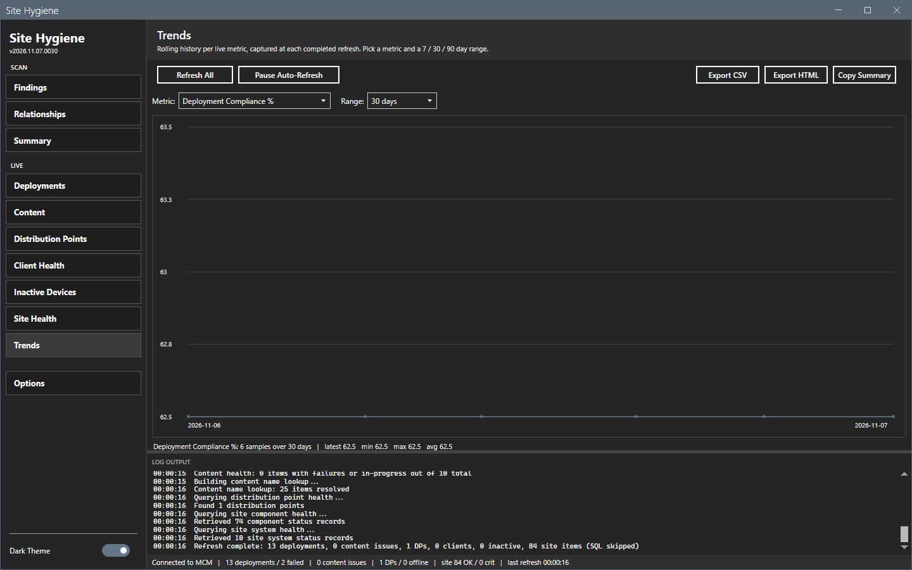
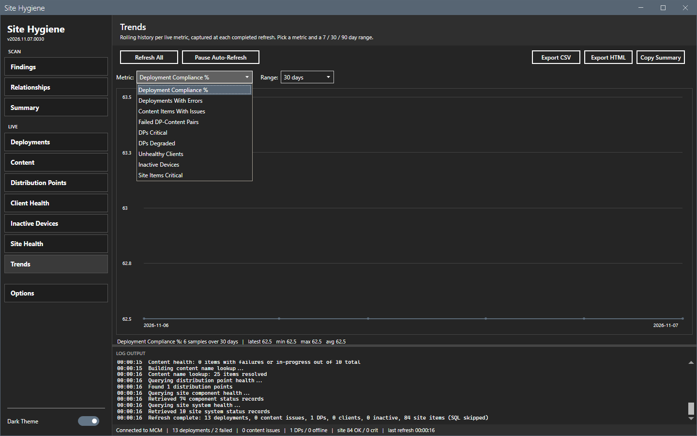
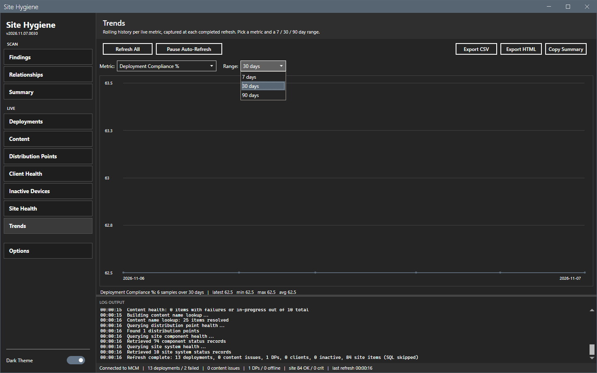
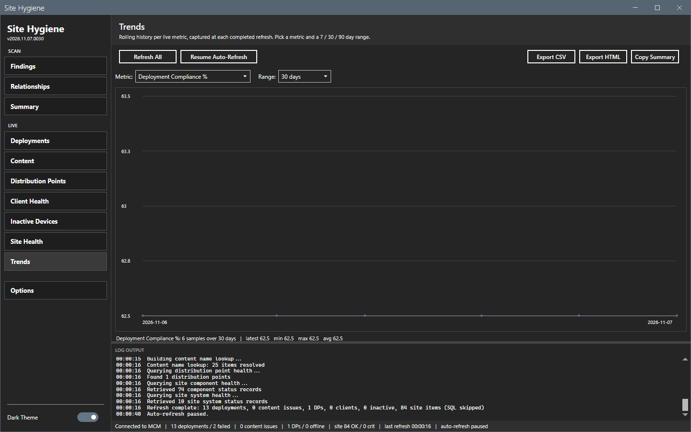

# Trends and alerts

The Trends view charts the live metrics over time. The auto-refresh timer and the threshold alerts work with the Live views.

## What it does

Each completed refresh adds one row of counts to the history. The Trends view draws one metric of the history over 7, 30 or 90 days. The tool keeps 180 days. An alert fires when a metric crosses into breach on a completed refresh.

## When to use it

Use it to see whether deployment compliance or the number of failed items gets better or worse, and to get a notice when a metric breaches.

## Requirements

At least one refresh of a Live view. Each refresh adds one point.

## Steps

### Read a chart

1. Select **Trends** in the sidebar.
2. Select a metric in the **Metric** list: **Deployment Compliance %**, **Deployments With Errors**, **Content Items With Issues**, **Failed DP-Content Pairs**, **DPs Critical**, **DPs Degraded**, **Unhealthy Clients**, **Inactive Devices** or **Site Items Critical**.
3. Select a range in the **Range** list: **7 days**, **30 days** or **90 days**.
4. Read the line below the chart: the number of samples, the latest, the minimum, the maximum and the average value.

### Pause the auto-refresh

1. Select **Pause Auto-Refresh**. The button changes to **Resume Auto-Refresh**.
2. Select the button again to resume.

The timer starts after the first refresh of a session. It also starts at launch when the window last showed a Live view. A session that only scans never polls. The interval is set under **Options > Live**. A manual refresh resets the timer.

### Get an alert

1. Select **Options > Alerts** and keep **Enable threshold alerts** on.
2. Set the **Deployment compliance floor**.
3. Refresh. When a metric breaches, the tool shows a Windows toast, writes a line to `Logs\SiteHygiene-alerts.log` and writes a line to the log pane.

An alert fires for a critical site component or site system, a critical distribution point, a failed DP-content pair, and a deployment compliance below the floor. An alert repeats only after the metric recovers and breaches again.

## Options and settings of this page

| Control | Effect |
|---|---|
| **Metric** list | Selects the series. |
| **Range** list | Selects 7, 30 or 90 days. |
| **Refresh All** | Runs a refresh and adds a point. |
| **Pause Auto-Refresh** | Holds or resumes the timer. |
| **Export CSV**, **Export HTML** | Write the charted series. |
| **Copy Summary** | Copies the text rollup. |

## Limits

- The history file keeps 180 days.
- The chart axis follows the data. A series with one value has an axis that spans a small range.
- A toast depends on Windows notifications. The line in the alerts log is always written.

## Troubleshooting

| Message or symptom | Cause | Fix |
|---|---|---|
| The chart is empty. | No refresh has run in the range. | Select **Refresh All**. |
| No toast shows. | Windows notifications are off for the session. | Read `Logs\SiteHygiene-alerts.log`. |

## Links

- [Live views](live-views.md)
- [Options dialog](options.md)
- [Files and logs](../reference/files-and-logs.md)
