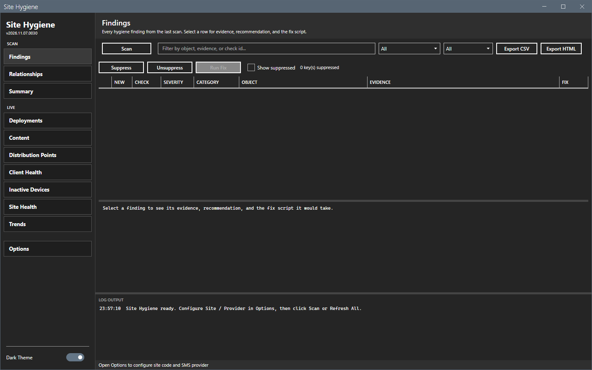
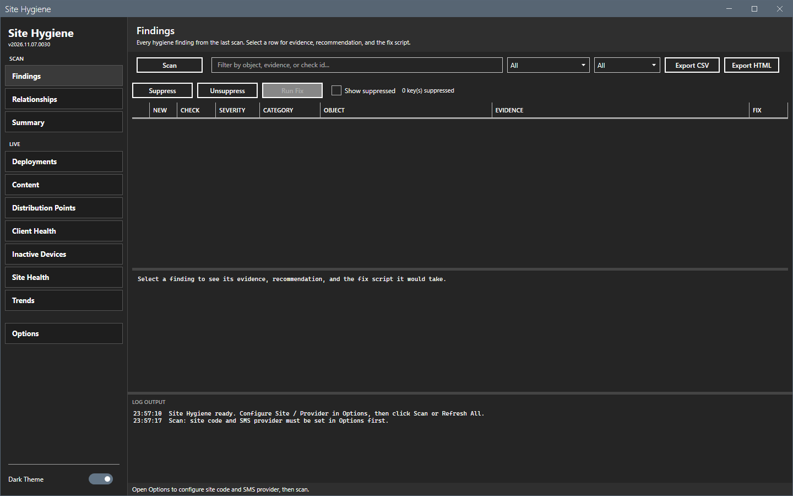
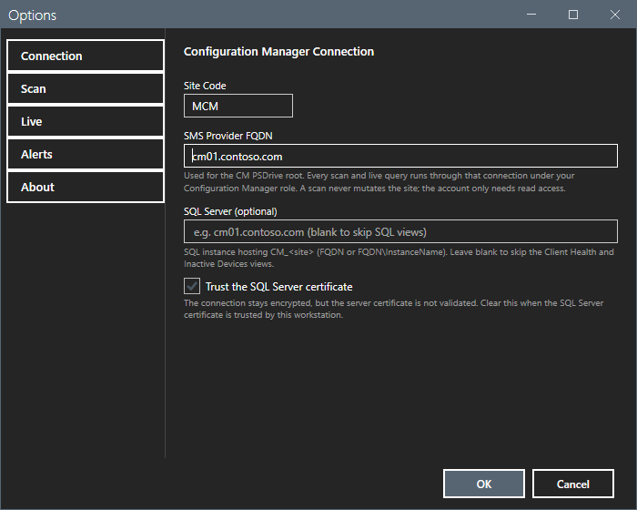
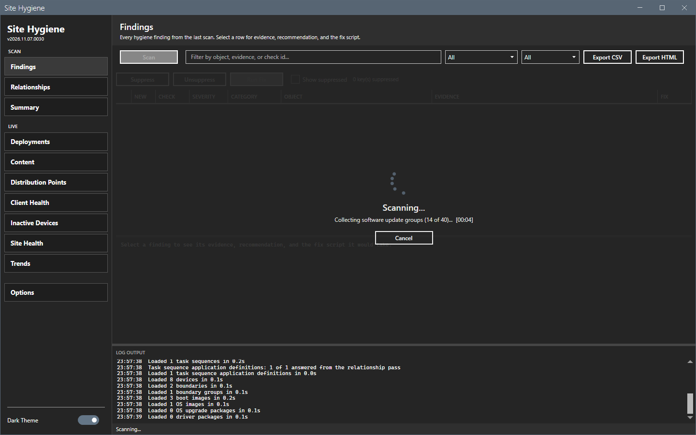
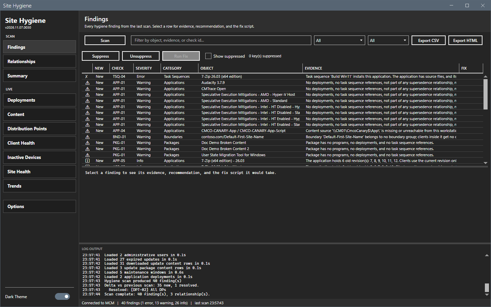

# Getting started

This page shows how to start Site Hygiene, set the connection and run the first scan.

## What it does

Site Hygiene reads a Configuration Manager site through its SMS Provider. It lists the findings of a scan, shows the status of the site on the Live views and runs a fix script only after you confirm it.

## When to use it

Use it to find unused applications and packages, dead collections, stale deployments and broken application relationships, and to watch deployment, content, distribution point, client and site status.

## Requirements

- Windows 10, Windows 11 or Windows Server 2016 or later, with PowerShell 5.1 and .NET Framework 4.7.2 or later.
- The Configuration Manager console. The tool loads the `ConfigurationManager` PowerShell module of the console. Without the console, a scan and a refresh fail with a message in the log. See [Error messages](reference/error-messages.md).
- Read access to the SMS Provider. See [Permissions](reference/permissions.md).
- Optional: the `SqlServer` PowerShell module and read access to the `CM_<site>` database for the Client Health and Inactive Devices views.

## Steps

### Start the tool

1. Extract the release zip to a folder that you can write to. The tool saves its settings, logs and reports in that folder.
2. Right-click `start-sitehygiene.ps1` and select **Run with PowerShell**. Or run this command:

```powershell
powershell -ExecutionPolicy Bypass -File start-sitehygiene.ps1
```

The window opens on the Findings view. The window of the first start is empty.



If you select **Scan** before you set the connection, the log asks you to open Options.



### Set the connection

1. Select **Options** in the sidebar.
2. Type the **Site Code**, for example `MCM`.
3. Type the **SMS Provider FQDN**, for example `cm01.contoso.com`.
4. Optional: type the **SQL Server** that hosts the `CM_<site>` database. Leave it blank to skip the Client Health and Inactive Devices views.
5. Select **OK**.



### Run the first scan

1. Select **Scan**. A progress overlay shows. **Cancel** on the overlay stops the scan.
2. Wait for the status bar to show `Scan complete`. A scan of the lab site takes about 30 seconds.
3. Read the findings. See [Findings](core/findings.md).





## Options and settings of this page

None. The settings are on [Options dialog](core/options.md).

## Limits

- A scan reads the whole site. It can take longer on a large site. Clear the areas that you do not need under **Options > Scan**.
- The window opens on the view that was open when you closed it.

## Troubleshooting

| Message or symptom | Cause | Fix |
|---|---|---|
| The log shows `Open Options to configure site code and SMS provider`. | The site code or the provider is empty. | Set the connection. |
| The log shows `ConfigurationManager module not found`. | The console is not installed on this computer. | Install the console. |

## Links

- [Findings](core/findings.md)
- [Options dialog](core/options.md)
- [Troubleshooting](troubleshooting.md)
