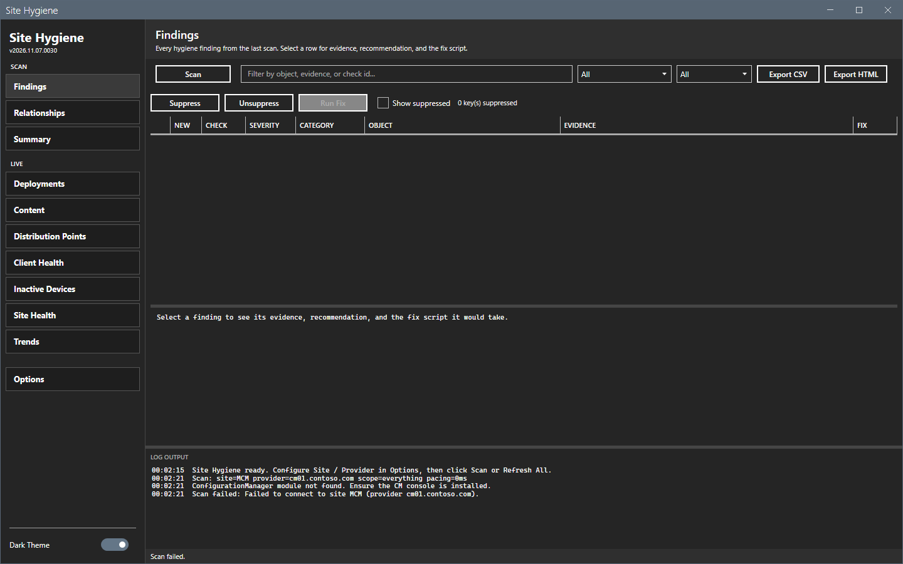
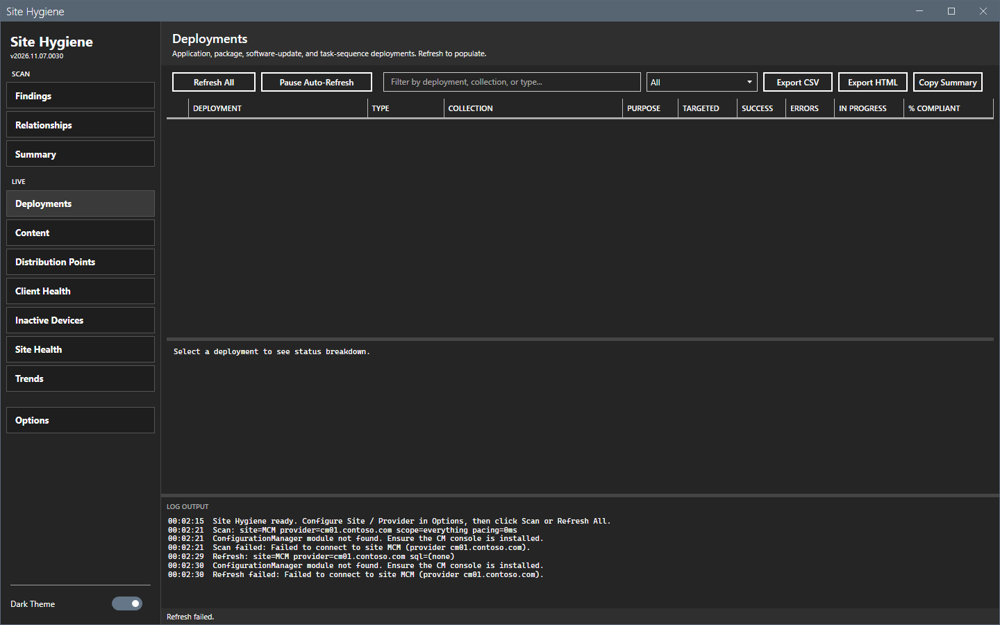

# Error messages

This page lists the messages of Site Hygiene with cause and fix. The messages show in the log pane, in the status bar and in message boxes.

## What it does

It maps a message to its cause and to a fix.

## When to use it

Use it when a scan, a refresh or a fix does not work.

## Requirements

None.

## Messages

| Message | Where | Cause | Fix |
|---|---|---|---|
| `Open Options to configure site code and SMS provider, then scan.` | Status bar | The site code or the provider is empty. | Set both in **Options > Connection**. |
| `Open Options to configure site code and SMS provider, then refresh.` | Status bar | The same, on a Live view. | The same. |
| `ConfigurationManager module not found. Ensure the CM console is installed.` | Log | The console is not installed on this computer, or `SMS_ADMIN_UI_PATH` does not point to the bin\i386 folder of the console. | Install the console. If it is installed, set `SMS_ADMIN_UI_PATH` to its bin\i386 folder and start the tool again. |
| `Scan failed: Failed to connect to site <code> (provider <name>).` | Log | The tool could not connect. The module is missing, the provider is wrong or not reachable, or the account has no access. | Check the console, the provider name, the network and the role. |
| `Refresh failed: Failed to connect to site <code> (provider <name>).` | Log | The same, on a refresh. | The same. |
| `Scan failed.` and `Refresh failed.` | Status bar | See the log line before. | Read the log. |
| `Select at least one scan area.` | Message box `Scan scope` | Every area is cleared. | Select an area. |
| `The pause must be a whole number of milliseconds from 0 to 60000.` | Message box `Scan` | The pause is not a number in range. | Type a whole number from 0 to 60000. |
| `Fix failed - see log.` and `Some fixes failed - see log.` | Status bar | A fix script failed on the site. | Read `Fix failed [<check>]` in the log. |
| `Scan cancelled.` and `Refresh cancelled.` | Status bar | You selected **Cancel** on the overlay. | Run again. |

The images show a scan and a refresh on a computer without the console. The window stays open, the grids stay empty and the log names the cause.

## Steps

1. Find the message in the table.
2. Do the fix.
3. Run the scan or the refresh again.

## Limits

- The messages are in English.

## Troubleshooting

See [Troubleshooting](../troubleshooting.md).

## Links

- [Troubleshooting](../troubleshooting.md)
- [Permissions](permissions.md)
